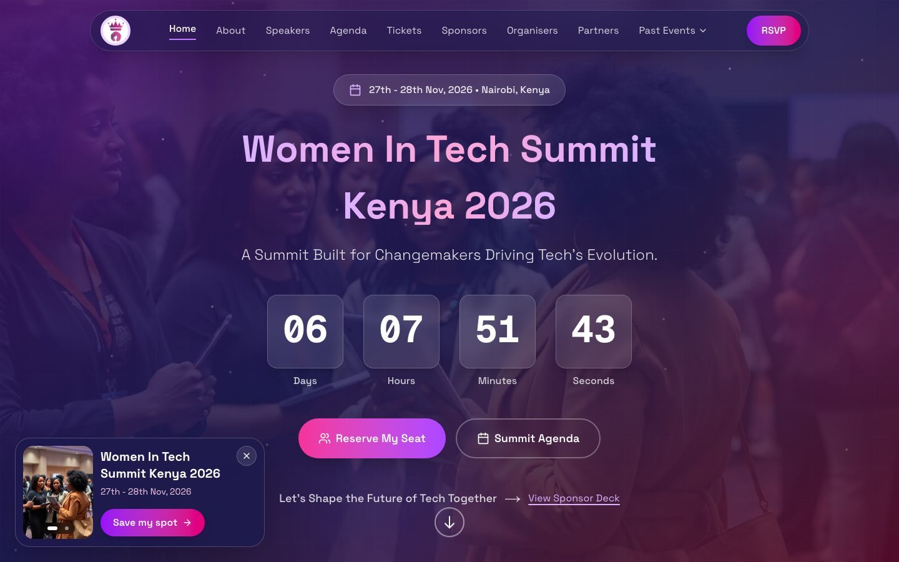

<div align="center">


# Women in Tech Summit Kenya

**A Summit Built for Changemakers Driving Tech's Evolution.**

The official open-source website for the Women in Tech Summit Kenya, run by
[Tambua Women in Tech](https://github.com/Tambua-WomenInTech-Blog).

[](https://summit.womenintechblog.dev)


<a href="https://summit.womenintechblog.dev">
  
</a>

<sub>The live homepage at <a href="https://summit.womenintechblog.dev">summit.womenintechblog.dev</a></sub>

</div>

---

## Contents

- [About](#about)
- [Tech stack](#tech-stack)
- [Getting started](#getting-started)
- [Project structure](#project-structure)
- [Common updates](#common-updates)
- [Contributing](#contributing)
- [Guidelines](#guidelines)
- [Deployment](#deployment)

## About

This repository holds the website for the summit: the hero and countdown,
speakers, agenda, tickets, sponsors, organisers, partners, and an archive of
past editions (starting with [2025](https://summit.womenintechblog.dev/past-events/2025/)).

It is a fully static site. There is no backend and no database, so anyone with
Node.js can run it locally in a couple of minutes.

## Tech stack

| Area      | Tool                                                      |
| --------- | --------------------------------------------------------- |
| Framework | [Next.js 15](https://nextjs.org) (App Router, static export) |
| UI        | React 19 + TypeScript                                     |
| Styling   | [Tailwind CSS 4](https://tailwindcss.com)                 |
| Icons     | [lucide-react](https://lucide.dev)                        |
| Hosting   | [Vercel](https://vercel.com)                              |

## Getting started

### Prerequisites

- [Node.js](https://nodejs.org) 20 or newer (`node -v` to check)
- npm, which comes with Node.js
- Git

### Setup

```bash
# 1. Fork the repo on GitHub, then clone your fork
git clone https://github.com/<your-username>/witsummitwebsite.git
cd witsummitwebsite

# 2. Install dependencies
npm install

# 3. Start the dev server
npm run dev
```

Open [http://localhost:3000](http://localhost:3000). The page reloads as you edit.

### Scripts

| Command         | What it does                                        |
| --------------- | --------------------------------------------------- |
| `npm run dev`   | Start the dev server with Turbopack                 |
| `npm run build` | Build the static site into `out/`                   |
| `npm run lint`  | Run ESLint                                          |

Run `npm run build` before opening a pull request. The site uses
`output: "export"`, so the build fails on anything that can't be rendered
statically, and it's better to find that out locally than in review.

To preview the production build, serve the `out/` folder:

```bash
npx serve out
```

## Project structure

```text
src/app/
├── page.tsx                 # Homepage: puts the sections together
├── layout.tsx               # Root layout, fonts and page metadata
├── sections/                # One file per homepage section (hero, agenda, partners, ...)
├── components/              # Shared pieces: header, promo card, CTA buttons
│   └── site-config.ts       # RSVP link, sponsor deck link, nav items, past events
├── data/speakers/           # Speaker lineups, one file per year
│   ├── 2025.ts
│   ├── 2026.ts
│   └── index.ts             # Registers each year and sets LATEST_EDITION
└── past-events/2025/        # Archive page for the 2025 edition
public/
├── speakers/                # Local speaker photos
└── sponsors/                # Sponsor and partner logos
```

## Common updates

Most contributions are content changes. Here's where each one lives.

<details>
<summary><b>Add or edit a speaker</b></summary>

Edit `src/app/data/speakers/2026.ts`. Each speaker looks like this:

```ts
{
  name: "Jane Doe",
  company: "Software Engineer - Acme",
  bio: "A short bio. Use \n for a new paragraph.",
  image: "https://drive.google.com/open?id=<file-id>",
}
```

`image` can be a Google Drive share link (it is turned into a thumbnail
automatically) or a path to a file in `public/speakers/`, such as
`"/speakers/jane.jpg"`. Leave it out to show a placeholder.

To change how many "Coming Soon" cards appear after the real speakers, set
`comingSoon` on that group.

</details>

<details>
<summary><b>Update the agenda</b></summary>

The schedule data is `defaultScheduleData` in
`src/app/past-events/2025/components/past-agenda-table.tsx`, and the section
heading and theme are in `src/app/sections/agenda-section.tsx`.

</details>

<details>
<summary><b>Change the RSVP or sponsor deck link</b></summary>

Both are in `src/app/components/site-config.ts` (`RSVP_URL` and
`SPONSOR_DECK_URL`). Every button on the site reads from there, so you only
change it once.

</details>

<details>
<summary><b>Add a sponsor or partner logo</b></summary>

Put the logo in `public/sponsors/` (PNG with a transparent background works
best), then add it to `src/app/sections/partners.tsx` or
`src/app/sections/community_backing.tsx`.

</details>

<details>
<summary><b>Start a new edition</b></summary>

1. Create `src/app/data/speakers/<year>.ts`, copying the shape of `2026.ts`.
2. Register it in `src/app/data/speakers/index.ts` and bump `LATEST_EDITION`.
3. Add an archive page under `src/app/past-events/<year>/` for the year that
   just ended, and add it to `pastEvents` in `site-config.ts`.

</details>

## Contributing

Contributions are welcome, from a typo fix to a new section. If you're new to
open source, this is a good place to start.

1. **Find or open an issue.** Check the
   [issues](https://github.com/Tambua-WomenInTech-Blog/witsummitwebsite/issues)
   first. For anything bigger than a small fix, open an issue to talk it
   through before you write code.
2. **Fork and branch.** Create a branch from `main` named after the change:

   | Prefix   | Use it for                      | Example                    |
   | -------- | ------------------------------- | -------------------------- |
   | `feat/`  | New features or sections        | `feat/speaker-update-2026` |
   | `fix/`   | Bugs, broken links, typos       | `fix/update_links_agenda`  |
   | `chore/` | Content or config housekeeping  | `chore/ticket-update-2026` |

3. **Make your change** and check it at both desktop and phone widths.
4. **Build and lint:** `npm run build && npm run lint`.
5. **Commit** with a short message that says what changed, for example
   `feat: add 2026 keynote speakers` or `fix: correct agenda start time`.
6. **Open a pull request** against `main`. Describe the change, link the issue,
   and add a screenshot for anything visual. Vercel posts a preview link on
   the PR so reviewers can see it running.

A maintainer will review it. Small content fixes are usually merged quickly.

## Guidelines

- **Keep it static.** The site is exported as static HTML. Don't add API
  routes, server actions, or anything that needs a running server.
- **Content lives in data and config.** Speaker details go in
  `data/speakers/`, links go in `site-config.ts`. Avoid hard-coding them
  inside components.
- **Mobile first.** Many attendees open the site on their phones. Check every
  change at phone width.
- **Accessible by default.** Give every image meaningful `alt` text, use real
  `<button>` and `<a>` elements, and keep text readable against the purple
  backgrounds.
- **Optimise images.** Compress photos before adding them to `public/`. Aim
  for under 300 KB per speaker photo.
- **Follow the existing style.** Use Tailwind utility classes and the
  existing purple and pink palette rather than new CSS files or colours.
- **Never commit secrets.** `.env*` files are git-ignored. Keep them that way.
- **Be kind.** Reviews are about the code, not the person. Everyone here is
  volunteering their time.

## Deployment

Vercel deploys the site automatically:

- every push to `main` goes to production at
  [summit.womenintechblog.dev](https://summit.womenintechblog.dev)
- every pull request gets its own preview deployment

There's nothing to deploy by hand.

### Updating the screenshot

The homepage image above is `docs/screenshots/desktop.jpg`. To refresh it
after a visible change goes live (needs `pip install playwright` and
`playwright install chromium`):

```bash
python3 - <<'EOF'
from playwright.sync_api import sync_playwright
with sync_playwright() as p:
    browser = p.chromium.launch()
    # Reduced motion keeps the promo card from being caught mid-fade
    page = browser.new_page(viewport={"width": 1440, "height": 900}, reduced_motion="reduce")
    page.goto("https://summit.womenintechblog.dev/", wait_until="networkidle")
    page.get_by_text("View sponsor deck").first.wait_for(state="visible")
    page.wait_for_timeout(2500)
    page.screenshot(path="docs/screenshots/desktop.jpg", type="jpeg", quality=82)
    browser.close()
EOF
```

---

<div align="center">

Made with 💜 by the [Tambua Women in Tech](https://github.com/Tambua-WomenInTech-Blog) community.

</div>
